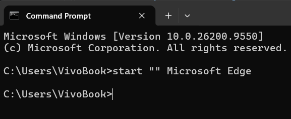

# 📝 Laporan Praktikum [PRAKTIKUM SISTEM TERDISTRIBUSI DAN TERDESENTRALISASI]

> **Modul [Nomor Modul]:** [Komunikasi Antar Proses pada Sistem Terdistribusi modul 2]  
> **Tanggal Praktikum:** [Tanggal Pelaksanaan]

---

## 👤 Informasi Mahasiswa
* **Nama:** RAYHAN PRATAMA 
* **NIM:** 255410018 
* **Kelas:** [IF-1]  
* **Dosen / Asisten Praktikum:** [Bambang Purnomosidi D.P., Dr., S.E., Ak., S.Kom., MMSI.]
---

## 🎯 1. Tujuan Praktikum
Setelah menyelesaikan praktikum ini, mahasiswa diharapkan dapat:
1. 🔹 [Tujuan Pertama, contoh: Memahami konsep dasar Array dalam pemrograman C++]
2. 🔹 [Tujuan Kedua, contoh: Mengimplementasikan algoritma pencarian linear]
3. 🔹 [Tujuan Ketiga, contoh: Menganalisis efisiensi dan kompleksitas kode yang dibuat]

---

## 🔬 2. Pembahasan Praktik

### 1. Cek Task Manager

Pembahasan

Setiap aplikasi, layanan latar belakang (background service), dan pustaka sistem yang dieksekusi oleh OS direpresentasikan sebagai sebuah Proses. Ketika perintah di atas dijalankan, sistem operasi menampilkan tabel yang berisi daftar seluruh proses yang sedang aktif beserta atribut-atribut utamanya, antara lain:

### 2. Cek APLIKASI WEB BROWSER

pembahasan

Saat aplikasi seperti Google Chrome dijalankan, sistem akan memanggil system call untuk membuat process block baru di memori dan mengalokasikan satu atau beberapa PID.

Pada aplikasi modern (multi-process architecture seperti Google Chrome), menjalankan satu aplikasi dapat memunculkan beberapa baris proses sekaligus (misalnya: main process, GPU process, serta renderer process untuk tiap tab yang terbuka). Dari perintah filter di atas, ditemukan PID utama dari aplikasi Chrome contoh PID: 12480

## 3. Me-restart aplikasi

pembahasan

Proses me-restart dan mematikan aplikasi pada sistem operasi dilakukan dengan mengirimkan sinyal perintah langsung ke kernel, di mana proses restart dilaksanakan melalui kombinasi perintah penghentian dan pemanggilan ulang aplikasi secara berurutan seperti taskkill /IM chrome.exe /F && start chrome pada Windows atau pkill chrome && chrome & pada Linux. Dalam mengeksekusi instruksi pemutusan tanpa tombol Exit, perintah taskkill /PID <PID> /F atau kill -9 <PID> memaksa kernel untuk mencabut seluruh alokasi memori dan daya pemrosesan secara seketika, sehingga jendela aplikasi langsung tertutup mendadak tanpa melewati prosedur penyimpanan data internal.

## 4. Penjelasan Seluruh Alur Kerja
Pemeriksaan Proses: Perintah ps aux atau tasklist meminta kernel sistem operasi untuk menampilkan tabel proses (Process Table). Kernel mencatat seluruh program yang sedang berjalan, alokasi memori, dan konsumsi CPU-nya.

Inisiasi Aplikasi: Saat perintah firefox dijalankan, system call (seperti fork() dan exec() di Unix/Linux) dipanggil untuk mengalokasikan ruang memori baru dan memberikan PID khusus kepada proses aplikasi tersebut.

Penghentian Paksa (Kill): Menggunakan kill atau taskkill mengirimkan sinyal penghentian langsung ke kernel (seperti sinyal SIGKILL atau SIGTERM di Linux). Sinyal ini menginstruksikan sistem operasi untuk langsung mencabut alokasi memori dan menghentikan eksekusi thread proses tersebut secara seketika, mengabaikan mekanisme penutupan internal aplikasi (seperti dialog "Simpan Perubahan").