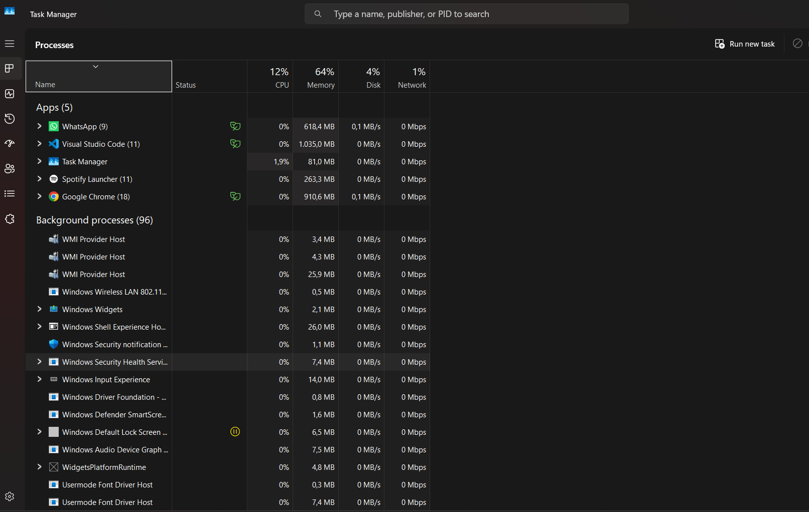
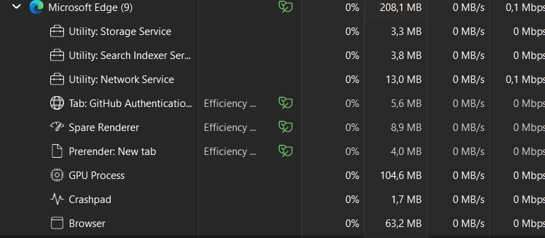

# 📝 Laporan Praktikum [Nama Mata Kuliah / Topik Praktikum]

> **Modul [Nomor Modul]:** [Judul Modul Praktikum]  
> **Tanggal Praktikum:** [Tanggal Pelaksanaan]

---

## 👤 Informasi Mahasiswa
* **Nama:** RAYHAN PRATAMA 
* **NIM:** 255410018 
* **Kelas:** [Kelas/Rombel]  
* **Dosen / Asisten Praktikum:** [Nama Dosen/Asdos]  

---

## 🎯 1. Tujuan Praktikum
Setelah menyelesaikan praktikum ini, mahasiswa diharapkan dapat:
1. 🔹 [Tujuan Pertama, contoh: Memahami konsep dasar Array dalam pemrograman C++]
2. 🔹 [Tujuan Kedua, contoh: Mengimplementasikan algoritma pencarian linear]
3. 🔹 [Tujuan Ketiga, contoh: Menganalisis efisiensi dan kompleksitas kode yang dibuat]

---

## 🔬 2. Pembahasan Praktik

### 1. Cek Task Manager

Pembahasan

Ini Pembahasan

### 2. Cek APLIKASI WEB BROWSER

pembahasan

ini pembahasan