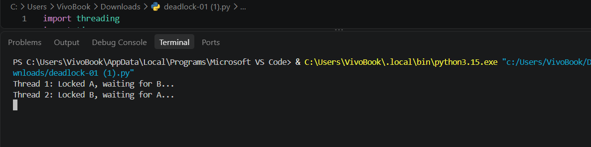
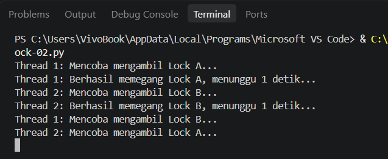

Laporan Praktikum [PRAKTIKUM SISTEM TERDISTRIBUSI DAN TERDESENTRALISASI]
Modul [Nomor Modul]: [Sinkronisasi pada Sistem Terdistribusi
2]
Tanggal Praktikum: [Tanggal 29 Pelaksanaan]

👤 Informasi Mahasiswa
Nama: RAYHAN PRATAMA
NIM: 255410018
Kelas: [IF-1]
Dosen / Asisten Praktikum: [Bambang Purnomosidi D.P., Dr., S.E., Ak., S.Kom., MMSI.]
🎯 1. Tujuan Praktikum
Setelah menyelesaikan praktikum ini, mahasiswa diharapkan dapat:

🔹 [Tujuan Pertama, contoh: Memahami konsep dasar Array dalam pemrograman C++]
🔹 [Tujuan Kedua, contoh: Mengimplementasikan algoritma pencarian linear]
🔹 [Tujuan Ketiga, contoh: Menganalisis efisiensi dan kompleksitas kode yang dibuat]
🔬 2. Pembahasan Praktik

